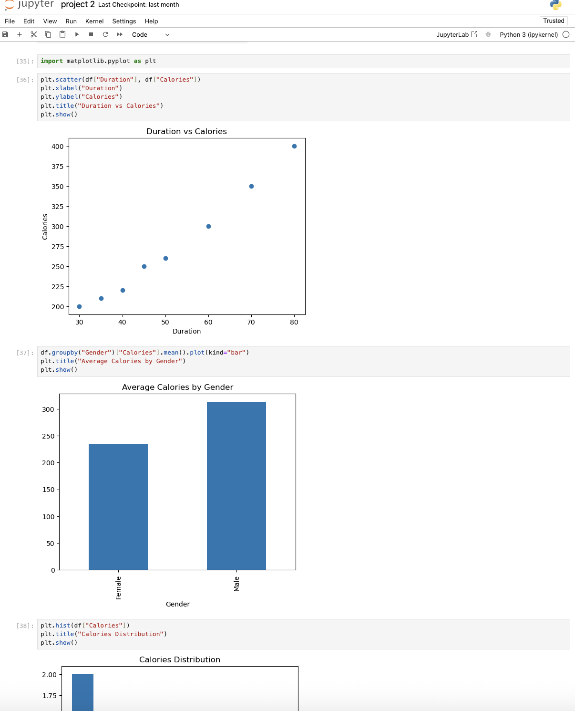
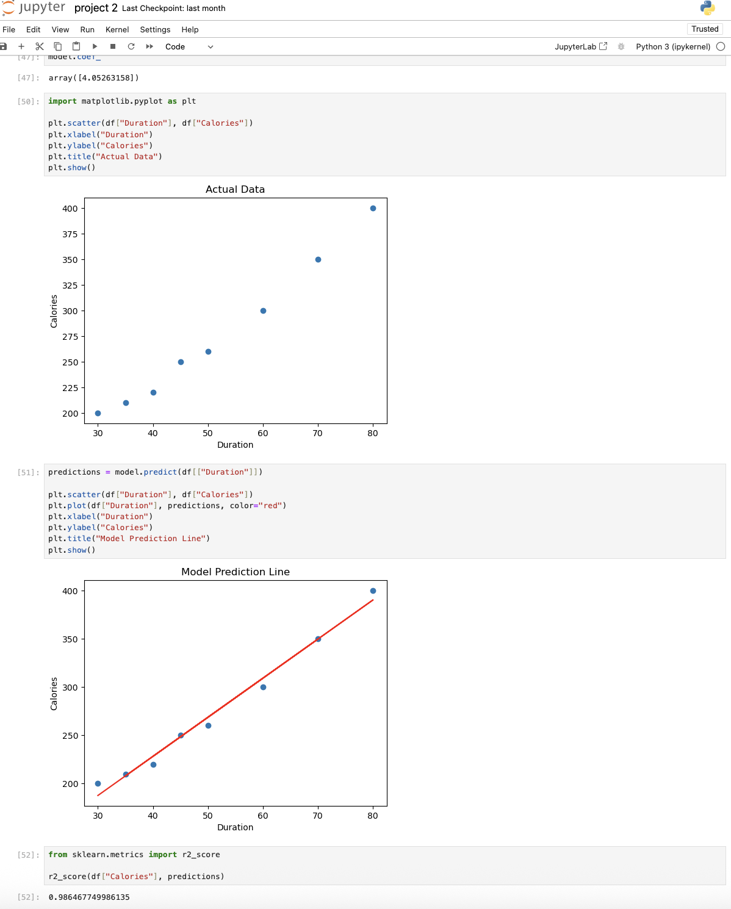

# Fitness Calorie Prediction

A machine-learning learning project using fitness exercise and calorie datasets.

## Repository contents

- `data/exercise.csv` and `data/calories.csv`: source datasets
- `data/final_data.csv`: prepared dataset
- `project 2.ipynb`: analysis and modelling notebook
- `screenshots/`: project screenshots

## Project scope

The notebook explores the data, prepares it for modelling, and includes a Linear Regression approach to estimate calories burned.

## Visuals

## Technologies

Python, pandas, Matplotlib, and scikit-learn.

## Reproducibility note

The repository does not yet include a dependency file or a documented evaluation metric. Any accuracy claim should be tied to a clearly defined test split and metric before it is presented as a result.

## Next improvements

- Add `requirements.txt`
- Document features, target variable, train/test split, and evaluation metric
- Export the notebook's key results into this README
